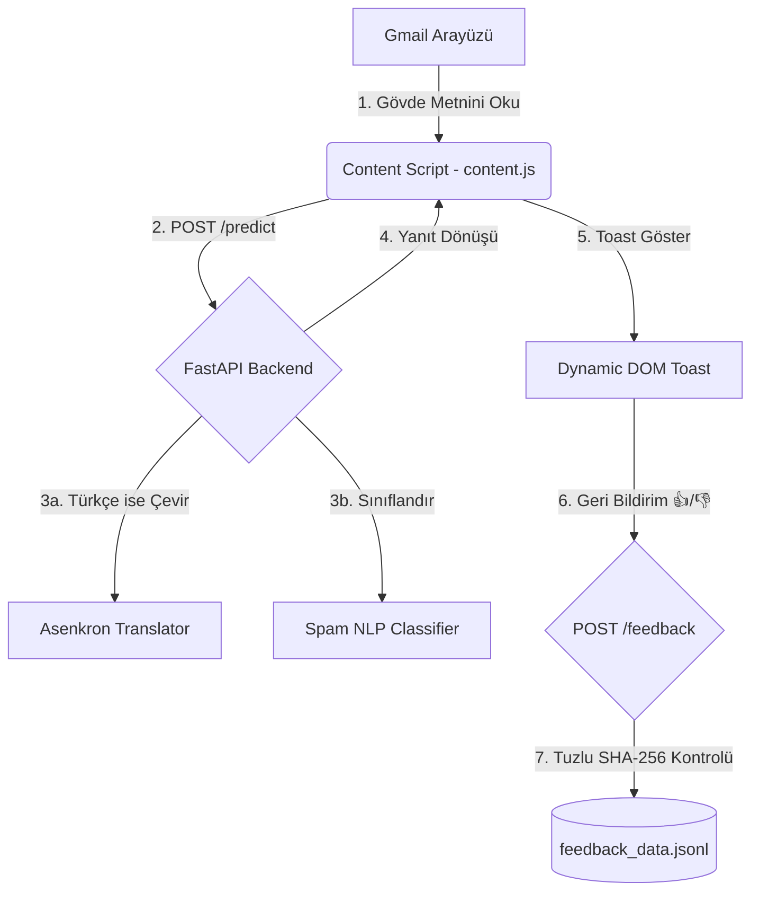

# 🛡️ Gmail Spam Filtresi v2 — Chrome MV3 & FastAPI

Gmail e-postalarınızı yapay zeka tabanlı algoritmalarla tarayan, şüpheli içerikleri anlık olarak analiz eden ve kullanıcı gizliliğini %100 koruyan gelişmiş bir Chrome Eklentisi ve FastAPI backend uygulamasıdır.

Eklenti, Gmail arayüzüne entegre olan sürükle-bırak destekli koruyucu bir buton yerleştirir. E-postayı tek tıkla analiz ederek sonucu modern, cam efektli (glassmorphic) animasyonlu bildirimlerle (toast) gösterir.

---

## 📸 Ekran Görüntüleri (Screenshots)

<!-- Görsel Boşluğu 1: Arayüz ve Genel Görünüm -->
> 🖼️ **[Görsel Ekle: Genel Kullanım Arayüzü ve Eklenti Pop-up Menüsü]**
> *Gmail üzerinde duran sürüklenebilir koruma butonu ve sağ üstteki pop-up menünün görselini buraya yerleştirebilirsiniz.*

<!-- Görsel Boşluğu 2: Toast Bildirim Kutusu ve 👍/👎 Butonları -->
> 🖼️ **[Görsel Ekle: Modern Toast Bildirimi ve Lucide SVG Oylama Butonları]**
> *Bir e-posta tarandıktan sonra çıkan anlık bildirim panelinin ve yeşil/kırmızı oylama animasyonlarının görselini buraya ekleyebilirsiniz.*

---

## ✨ Öne Çıkan Özellikler (Features)

*   **Sürüklenebilir Akıllı Buton:** Gmail DOM'u ile tam uyumlu, ekran kenarlarına animasyonlu yapışan (snap-to-edge) ve CPU'yu yormayan sürükle-bırak kontrol butonu.
*   **Cam Efektli (Glassmorphism) Toast Bildirimleri:** Tahmin sonuçlarını (Ham / Spam / Şüpheli) ve güven oranını şık mikro-animasyonlar ve progres çubukları ile gösteren modern bildirim kutuları.
*   **Lucide SVG Geri Bildirim Butonları:** Sistem emojileri yerine, üzerine gelindiğinde dikey kayma, gölge ve dönme açısı kazanan premium inline SVG oylama butonları.
*   **%100 Kullanıcı Anonimliği (Zero-Knowledge):** Geri bildirim loglarında asla `user_id` saklanmaz! Çift oylamaları (spam) engellemek için eklenti tarafında üretilen benzersiz anonim kimlik, sunucu tarafında **Tuzlu SHA-256 (Salted SHA-256)** hash'ine dönüştürülerek saklanır.
*   **DOM XSS ve Prototype Pollution Koruması:** `innerHTML` ve dinamik template string kullanımı tamamen terk edilerek, tarayıcı düzeyinde yerel DOM elemanı inşasına geçilmiş; zafiyetler kapatılmıştır.
*   **Hızlı Asenkron Backend:** FastAPI, Türkçe mailleri asenkron olarak İngilizceye çeviren fail-safe API uç noktaları ve SHA-256 tabanlı yüksek performanslı önbellekleme (caching) mekanizması.

---

## 🏛️ Mimari Yapı (Architecture)



---

## 🚀 Kurulum ve Çalıştırma (Installation & Setup)

Proje iki ana bileşenden oluşmaktadır: **Python FastAPI Backend** ve **Chrome MV3 Uzantısı**.

### 1. Backend Kurulumu (FastAPI Server)

#### Gereksinimler:
*   Python 3.8 veya üzeri

#### Adımlar:
1.  Gerekli bağımlılıkları yükleyin:
    ```bash
    pip install -r requirements.txt
    ```
    *(Not: Eğer `requirements.txt` yoksa `fastapi`, `uvicorn`, `pydantic` ve projenin kullandığı diğer NLP/Çeviri kütüphanelerini yükleyin).*

2.  Sunucuyu yerel ağda/yerelde başlatın:
    ```bash
    python -m uvicorn main:app --reload --host 127.0.0.1 --port 8000
    ```
    Sunucu artık `http://127.0.0.1:8000` adresinde istekleri kabul etmeye hazırdır.

---

### 2. Chrome Eklentisi Kurulumu (Extension)

1.  Google Chrome tarayıcınızı açın ve adres çubuğuna `chrome://extensions/` yazarak uzantılar sayfasına gidin.
2.  Sağ üst köşede yer alan **"Geliştirici modu" (Developer mode)** anahtarını aktif hale getirin.
3.  Sol üstte çıkan **"Paketlenmemiş öğe yükle" (Load unpacked)** butonuna tıklayın.
4.  Projenin içindeki **`extension`** klasörünü seçip yükleyin.
5.  Eklenti artık Gmail sayfanızda aktif olacaktır! Sayfayı yenileyerek sağ/sol kenarda 🛡️ butonunu görebilirsiniz.

---

## ⚙️ Yerel Ağda veya Başka Cihazda Çalıştırma
Sunucuyu yerel ağdaki (LAN) başka bir cihaza taşımak ve eklentiyi o adrese bağlamak isterseniz, adım adım anlatımı içeren **[DEPLOYMENT.md](file:///c:/mycodes/personal/spam-filter2/DEPLOYMENT.md)** kılavuzunu inceleyebilirsiniz.

---

## 🔒 Güvenlik Sertifikasyonu (Security Audit)
Uygulama, **SecureCoder** statik analiz aracı denetimlerinden başarıyla geçmiştir. 
*   Braket notasyonları (`[]`) yerine prototip kirlenmesini önleyen JavaScript `Map` yapıları kullanılmıştır.
*   `innerHTML` yerine tamamen `createTextNode` tabanlı güvenli DOM inşası uygulanmıştır.
*   Kriptografik cache yapısında MD5 yerine yüksek dirençli **SHA-256** tercih edilmiştir.

Detaylı denetim raporlarına **[walkthrough.md](file:///c:/Users/can/.gemini/antigravity-ide/brain/c7b7a56d-f0f5-4799-99dc-457d61be4343/walkthrough.md)** dosyasından ulaşabilirsiniz.
